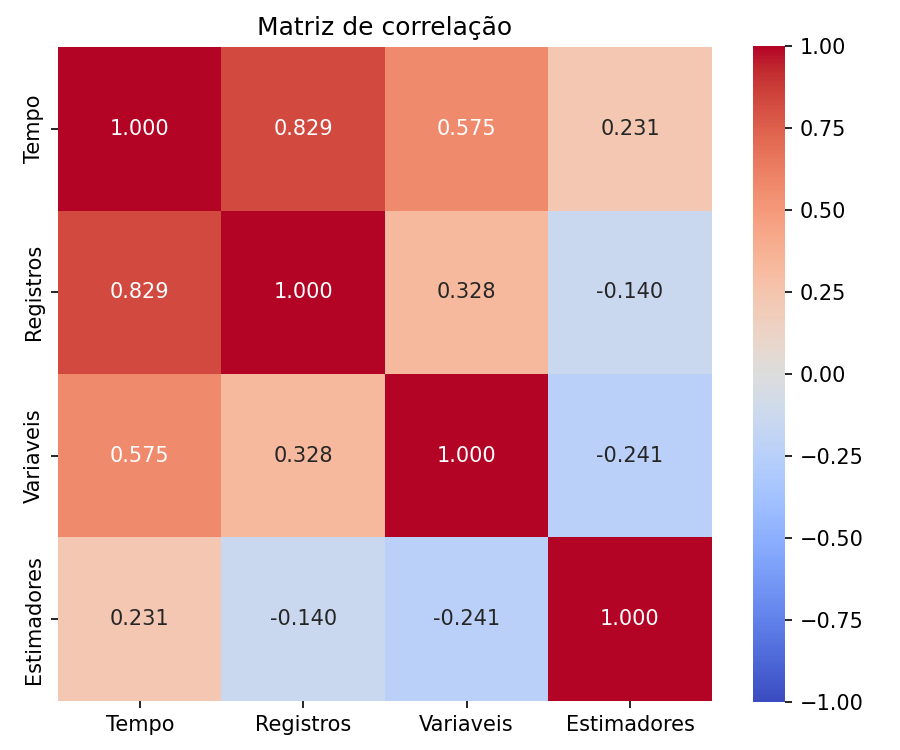
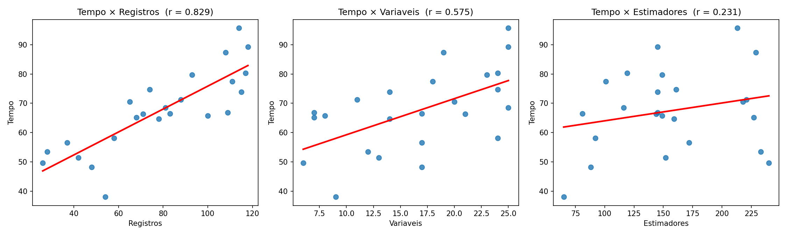
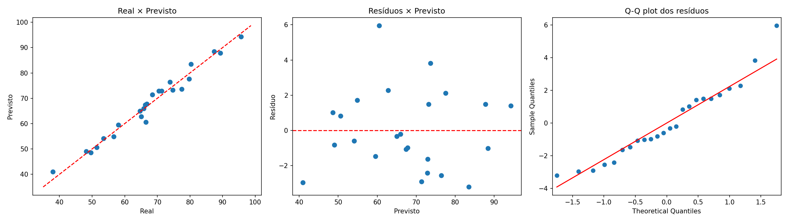

# Problema 3: Previsão do tempo de treinamento de modelos de Machine Learning

Análise estatística com **Regressão Linear Múltipla (OLS)** em Python para explicar e prever quanto tempo leva o treinamento de um modelo de Machine Learning.

> Trabalho da disciplina **Métodos Quantitativos em Computação**, Bacharelado em Ciência da Computação, Universidade de Fortaleza (UNIFOR), 2026.
> Este repositório contém a **Situação-Problema 3** do relatório *"Análise de Correlação e Modelagem por Regressão Linear Simples e Múltipla"*.

---

## Sumário

1. [Contexto](#contexto)
2. [Base de dados](#base-de-dados)
3. [Como executar](#como-executar)
4. [Metodologia](#metodologia)
5. [Resultados](#resultados)
6. [Conclusões](#conclusões)
7. [Limitações](#limitações)
8. [Estrutura do repositório](#estrutura-do-repositório)
9. [Autores](#autores)

---

## Contexto

Uma equipe de Ciência de Dados percebeu que alguns modelos treinam em poucos minutos e outros demoram muito mais. A hipótese é que o tempo depende de três fatores:

| Fator | Descrição |
|---|---|
| **Registros** | Quantidade de linhas da base de treino |
| **Variáveis** | Quantidade de colunas (features) da base |
| **Estimadores** | Número de estimadores (ex.: árvores em um ensemble) |

**Pergunta de pesquisa:** quais fatores mais influenciam o tempo de treinamento, e é possível prever o tempo de novos experimentos?

## Base de dados

24 experimentos de treinamento, com as colunas `Tempo` (segundos), `Registros`, `Variaveis` e `Estimadores`. Os dados estão embutidos no próprio script `analise_problema3.py`.

## Como executar

```bash
# 1. Clonar o repositório
git clone https://github.com/<seu-usuario>/<seu-repositorio>.git
cd <seu-repositorio>

# 2. (Opcional) criar ambiente virtual
python -m venv venv
source venv/bin/activate        # Windows: venv\Scripts\activate

# 3. Instalar dependências
pip install -r requirements.txt

# 4. Rodar a análise
python analise_problema3.py
```

O script imprime todos os resultados no terminal, salva as três figuras (`fig_correlacao.png`, `fig_dispersao.png` e `fig_diagnostico.png`) na pasta onde foi executado e abre as janelas dos gráficos ao final (`plt.show()`).

## Metodologia

O script segue seis etapas:

1. **Análise exploratória**: estatísticas descritivas, coeficiente de variação, matriz de correlação de Pearson e gráficos de dispersão.
2. **Modelo de regressão múltipla** estimado por Mínimos Quadrados Ordinários (`statsmodels.OLS`).
3. **Qualidade do ajuste**: R², R² ajustado e erro-padrão residual.
4. **Significância estatística** (α = 0,05): Teste F global e Testes t por coeficiente.
5. **Importância relativa**: coeficientes padronizados (beta), conferidos por uma regressão com variáveis em z-score, e VIF para multicolinearidade.
6. **Previsão e diagnóstico**: previsão para um novo cenário, intervalos de confiança e de predição, gráficos de resíduos, Shapiro-Wilk, Durbin-Watson e métricas de erro.

## Resultados

### 1. Análise exploratória

| Estatística | Tempo (s) | Registros | Variáveis | Estimadores |
|---|---:|---:|---:|---:|
| Média | 67,475 | 78,583 | 16,667 | 156,833 |
| Desvio-padrão | 13,896 | 29,460 | 6,472 | 52,828 |
| Mínimo | 38,0 | 26 | 6 | 65 |
| Máximo | 95,7 | 118 | 25 | 240 |
| Coef. de variação | 20,59% | 37,49% | 38,83% | 33,68% |

**Correlação de Pearson com o tempo de treinamento:**

| Variável | r | Classificação |
|---|---:|---|
| Registros | +0,8292 | Forte e positiva |
| Variáveis | +0,5749 | Moderada e positiva |
| Estimadores | +0,2314 | Fraca e positiva |

Os preditores têm correlação baixa entre si (de -0,24 a +0,33), um primeiro indício de que não há multicolinearidade.





### 2. Modelo de regressão

```
Tempo = 5,9367 + 0,3527 × Registros + 0,9371 × Variáveis + 0,1161 × Estimadores
```

| Coeficiente | Valor | Interpretação (mantendo os outros fatores constantes) |
|---|---:|---|
| Intercepto | 5,94 s | Tempo base quando todos os fatores são zero (valor teórico) |
| Registros | 0,3527 | Cada registro a mais acrescenta ~0,35 s |
| Variáveis | 0,9371 | Cada variável a mais acrescenta ~0,94 s |
| Estimadores | 0,1161 | Cada estimador a mais acrescenta ~0,12 s |

### 3. Qualidade do ajuste

| Métrica | Valor |
|---|---:|
| R² | 0,9731 |
| R² ajustado | 0,9690 |
| Diferença | 0,0041 |
| Erro-padrão residual | 2,4453 s |

O modelo explica cerca de **97%** da variação do tempo. A diferença mínima entre R² e R² ajustado indica que não há sobreajuste.

### 4. Significância estatística (α = 0,05)

| Teste | Estatística | p-valor | Decisão |
|---|---:|---:|---|
| **F (modelo global)** | 240,922 | 7,32 × 10⁻¹⁶ | Rejeita H₀: modelo significativo |
| t (Registros) | 19,213 | 2,32 × 10⁻¹⁴ | Significativo |
| t (Variáveis) | 10,990 | 6,33 × 10⁻¹⁰ | Significativo |
| t (Estimadores) | 11,643 | 2,31 × 10⁻¹⁰ | Significativo |

### 5. Importância relativa

Os coeficientes brutos **não** podem ser comparados diretamente, pois cada variável tem unidade e escala diferentes. Por isso usamos os coeficientes padronizados (β\* = b × sₓ / s_y):

| Variável | Beta padronizado | VIF |
|---|---:|---:|
| **Registros** | **0,7478** | 1,125 |
| Estimadores | 0,4412 | 1,067 |
| Variáveis | 0,4364 | 1,171 |

**Registros** é o fator de maior impacto relativo. Todos os VIFs ficaram próximos de 1, então não há multicolinearidade preocupante (o limite usual de alerta é 5 a 10).

### 6. Previsão e diagnóstico

Novo cenário: **80 registros, 15 variáveis e 150 estimadores**.

| Indicador | Valor |
|---|---:|
| Tempo previsto | **65,62 s** |
| IC 95% para o tempo médio | [64,51 ; 66,73] s |
| Intervalo de predição 95% (execução individual) | [60,40 ; 70,84] s |
| MAE | 1,842 s |
| RMSE | 2,232 s |
| MAPE | 2,81% |
| Shapiro-Wilk (normalidade dos resíduos) | W = 0,9478, p = 0,2428 |
| Durbin-Watson (independência) | 2,1342 |

Como p > 0,05 no Shapiro-Wilk, **não há evidência contra a normalidade** dos resíduos. O Durbin-Watson próximo de 2 indica ausência de autocorrelação.



## Conclusões

- O tempo de treinamento é explicado por **registros, variáveis e estimadores**, e os três são estatisticamente significativos.
- O **número de registros** é o fator mais determinante (β\* = 0,75).
- O modelo explica ~97% da variação do tempo e tem erro percentual médio de ~2,8%, o que o torna adequado para **estimar custos de computação antes de rodar um treinamento**.
- Os pressupostos (normalidade, independência dos resíduos e ausência de multicolinearidade) foram verificados.

## Limitações

- **Amostra pequena** (n = 24): os intervalos de confiança são relativamente sensíveis a poucos pontos.
- O modelo é **linear**. Algoritmos reais podem ter relações não lineares com o tamanho da base.
- Previsões **fora da faixa observada** (26 a 118 registros, 6 a 25 variáveis, 65 a 240 estimadores) são extrapolações e devem ser feitas com cautela.
- O intercepto (5,94 s) é um valor teórico, pois o cenário com tudo igual a zero não existe na prática.
- Correlação e regressão indicam associação. A relação causal vem do conhecimento do domínio (mais dados exigem mais processamento).

## Estrutura do repositório

```
.
├── README.md
├── requirements.txt
├── analise_problema3.py     # Script completo da análise
├── fig_correlacao.png       # Heatmap da matriz de correlação
├── fig_dispersao.png        # Dispersão Tempo × cada preditor
└── fig_diagnostico.png      # Real × Previsto, Resíduos e Q-Q plot
```

## Tecnologias

Python 3 · pandas · NumPy · statsmodels · SciPy · Matplotlib · Seaborn

## Autores

- Anderson Herculano de Lima
- Érika Karine Duarte da Silva
- Isabella Gaspar Anton

**Orientadora:** Profa. Dra. Vera Lúcia da Silva
UNIFOR, Centro de Ciências Tecnológicas, Fortaleza, CE, 2026
